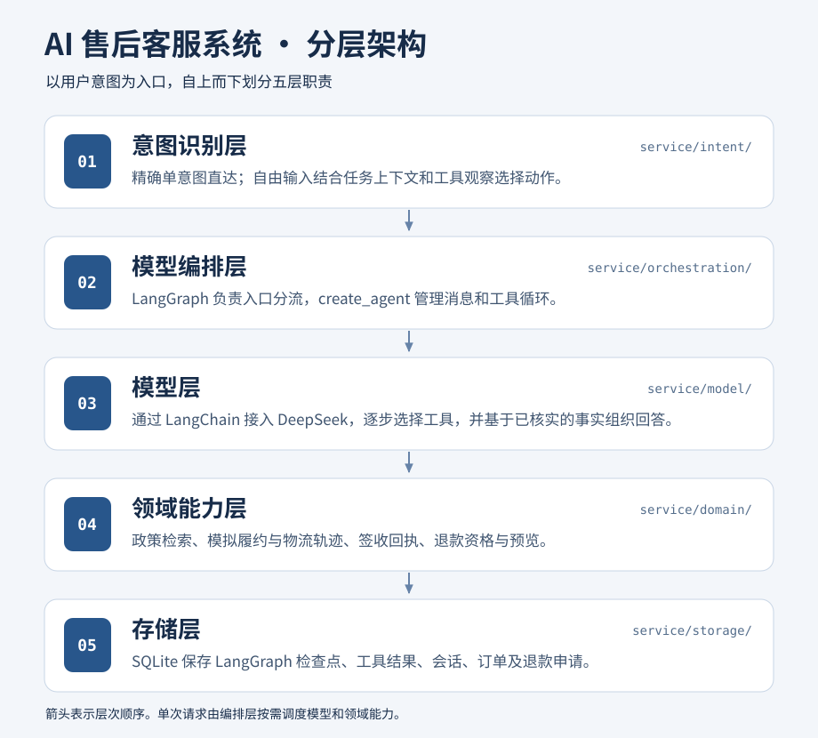

# AI 售后服务

使用 TypeScript、LangChain `createAgent`、LangGraph 和 DeepSeek 的中文售后演示。本地与 Cloudflare Workers 共用请求处理、Agent、领域工具和知识库。每位访客有独立的虚构订单，退款只登记为「已受理（模拟）」。

## 本地体验

需要 Node.js 22.13 或更新版本、npm 和 DeepSeek API Key。在项目根目录的 `.env` 中配置密钥，该文件已被 Git 忽略。

```dotenv
DEEPSEEK_API_KEY=填写你的密钥
DEEPSEEK_BASE_URL=https://api.deepseek.com
```

```sh
npm ci
npm run dev
```

打开 [本地服务台](http://127.0.0.1:8000/)。输入「查物流，再看看能不能退」，选中阅读灯后，客服继续查询物流和退款资格。点击确认提交，再刷新页面查询退款进度。

`npm run dev` 自动构建知识库，使用 Node.js 本地入口和 `data/support.sqlite`。本地入口复用 `workers/index.ts`，通过 SQLite 适配项目使用的 D1 接口。可用 `PORT=8001 npm run dev` 更换端口。修改代码或知识库后重启。

支持 Cloudflare 本地运行时的系统也可执行 `npm run dev:worker`，它先初始化本地 D1，再运行 Wrangler。本地 D1 数据位于 `.wrangler/`，与 Node.js 入口的 SQLite 文件独立。当前 macOS 13.1 不满足 workerd 所需的最低系统版本，因此默认使用 Node.js 入口。

模型名和退款期限常量位于 `workers/constants/index.ts`。修改退款期限时，同步更新 `knowledge/` 中的政策及测试。

## 分层架构



| 职责 | 代码入口 | 负责的决定 |
| --- | --- | --- |
| 意图识别 | `workers/intent/` | 完整指令精确匹配；自由输入交给 Agent，选单按钮在编排入口校验。 |
| 模型编排 | `workers/orchestration/` | `createAgent` 原生消息与工具循环，顺序执行多工具调用，使用 `interrupt()` 和 `Command(resume)` 续办，组织页面结果。 |
| 模型接入 | `workers/model/` | 初始化 DeepSeek 的 LangChain 模型，集中配置连接参数、超时和重试。 |
| 领域能力 | `workers/domain/` | 工具定义、订单选择、模拟物流与履约、中文二元组 BM25 政策检索。 |
| 存储 | `workers/storage/` | SQL 表结构、订单与退款读写及资格复核、确认幂等、LangGraph 检查点；本地 SQLite 和线上 D1。 |

`workers/index.ts` 提供同源 JSON API，`public/` 提供网页。`scripts/dev.ts` 是本地 HTTP 与静态资源适配入口。生产环境由 Wrangler 绑定 D1 和静态资源。`workers/logging/` 统一记录开发日志，`scripts/` 负责构建、启动、验收和流程图导出。

### LangGraph 执行流程



```sh
npm run graph
```

脚本从当前 `createSupportAgent()` 实例调用 LangGraph 的 `getGraphAsync()`，通过 `drawMermaid()` 导出 `docs/chat-flow.mmd`，再用相同的节点与连线数据生成 SVG。SVG 排版由项目脚本完成，导出无需访问模型或数据库。图展示 Agent 内部循环，精确规则和 HTTP 确认在图外处理。

1. 自由输入成为 `HumanMessage`，Agent 带上最近六轮对话调用 DeepSeek。
2. 模型返回工具调用后，中间件每次只放行一个，其余调用保存在 AIMessage 的 `pendingTools` 中。工具结果以 `ToolMessage` 返回，确认卡存放在 `artifact` 中。
3. 工具缺少订单时执行 `interrupt()`，检查点保存到数据库。选单后用相同 `thread_id` 和 `Command(resume={order_id})` 恢复，继续剩余工具。
4. 退款资格由后端核验。完成后保存问答摘要并清理本轮检查点。用户点击确认时通过独立接口复核票据、归属和期限，再创建模拟申请。

| 输入或操作 | 预期行为 |
| --- | --- |
| 查看我的订单 | 精确规则返回当前访客订单。 |
| 查物流，再看看能不能退 | 等待选单，恢复后返回物流、退款资格及可用确认卡。 |
| 退货运费谁承担 | 返回政策原文及标题。 |
| 查询退款进度 | 返回该访客已提交的模拟申请。 |

### 知识库构建

在 `knowledge/` 放置 Markdown 或 TXT 文件。`npm run knowledge` 按标题与段落切块，生成词频和文档频率。中文使用字符二元组，英文数字按词索引。生成文件为 `workers/domain/index.generated.json`，不会提交到 Git，每次构建自动生成。Worker 内执行 BM25 排序；资料缺失时返回缺少依据。

## 测试与验收

```sh
npm run check
npm test
npm run build
# 本地服务启动后，使用真实 DeepSeek 完成模拟退款验收
npm run verify -- http://127.0.0.1:8000
# 验收线上服务，使用全新的隔离访客
npm run verify -- https://smart-customer-service.chenshuofeng0131.workers.dev
```

自动测试使用 Node.js 测试运行器、SQLite 和替代模型，验证检索、多工具调用、关闭数据库后恢复检查点、退款期限、取消票据、并发确认及访客隔离。真实验收会创建演示订单并提交一笔模拟申请。DeepSeek 上游不可用时，初次识别可能返回 503；已获得工具结果时可以展示核实结果。

## 查看任务流转日志

本地 `npm run dev` 将结构化事件追加到 `data/logs/tasks.jsonl`，并自动更新 `data/logs/tasks.pretty.json`。单文件达到 5 MiB 后轮转，保留三份备份。

```sh
tail -f data/logs/tasks.jsonl
# 按脱敏的访客线程编号查询选单前后的事件
rg --fixed-strings '任务编号' data/logs/
# 查看线上实时开发日志
npx wrangler tail smart-customer-service
```

`model.request` 包含系统 Prompt 和消息，`model.response` 包含模型正文与工具调用，`tool.request/result` 包含工具入参和结果，`task.wait/resume` 记录等待选单和恢复，`chat.request/response` 记录接口输入输出。线上同样输出到 Worker 日志，日志仅供开发人员查看。访客线程编号经过哈希，票据和密钥字段脱敏。中断恢复会重放工具，因此可能再次出现同一工具的请求日志。

## HTTP 接口

客户端保存服务端签发的 HttpOnly 访客 Cookie，生产环境带 Secure 与 SameSite=Strict。本地 HTTP 开发入口去掉 Secure 属性。

| 方法 | 路径 | 用途 |
| --- | --- | --- |
| GET | `/health` | 检查数据库连接 |
| GET | `/api/orders` | 当前访客的订单 |
| POST | `/api/chat` | 接收 `message` 和可选 `action`，返回正文、引用与可选卡片 |
| POST | `/api/refunds/confirm` | 接收 `ticket`，复核后提交；重复确认返回同一申请 |
| GET | `/api/refunds/{id}` | 当前访客的申请详情 |

## Cloudflare Workers 免费版与 D1

GitHub Workers Builds 项目名为 `smart-customer-service`，生产分支为 `main`，根目录为仓库根目录，Build command 留空，Deploy command 使用 `npx wrangler deploy`。npm 锁文件固定 Wrangler 版本，部署钩子运行 TypeScript 知识库构建。

```sh
npm ci
# 新账户先创建 D1，再把账户和数据库 ID 填入 wrangler.jsonc
npx wrangler d1 create smart-customer-service-db
npx wrangler d1 execute smart-customer-service-db --remote --file workers/storage/schema.sql
npx wrangler secret put DEEPSEEK_API_KEY
npx wrangler secret put DEEPSEEK_BASE_URL
npm run deploy
```

生产 Secrets 在 Worker 运行时读取。D1 保存订单、申请和待续办检查点，发布新版本后仍可恢复。建表脚本幂等，已有线上表结构继续使用。[Workers Builds](https://developers.cloudflare.com/workers/ci-cd/builds/) · [D1 绑定](https://developers.cloudflare.com/d1/worker-api/d1-database/)
