# 售后客服系统文档

## LangGraph 执行流程

蓝色节点之间的往返表示 ReAct 循环：模型选择工具，工具把结果交回模型。需要用户补充时，执行工具节点通过 interrupt() 等待，下一次请求通过 Command 恢复该节点。

[查看 Mermaid 源文件](chat-flow.mmd) · [节点说明与重新生成命令](../README.md#langgraph-执行流程)
